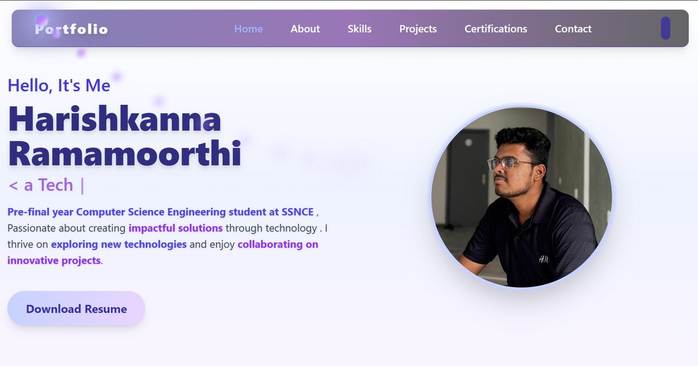

# Harishkanna R — Personal Portfolio

A responsive single-page portfolio built with React 19, TypeScript, Vite, and Tailwind CSS. It showcases my projects, research, skills, certifications, and experience, with a dark/light theme and a working contact form.



## Features

- **Dark / light theme** with the saved choice applied before first paint (no flash)
- **Project showcase** with category filters, a featured-first view, and a detail dialog per project
- **Timeline and certifications** for education, experience, hackathons, and research
- **Contact form** using EmailJS, with a honeypot field against bots
- **Accessible motion**: animations respect `prefers-reduced-motion`
- **Performance-minded**: all images are WebP (about 1.2 MB total), below-the-fold images are lazy-loaded, and the pointer glow runs outside React renders
- **SEO**: meta description, canonical URL, Open Graph and Twitter cards

## Tech stack

| Area | Tools |
|---|---|
| Framework | React 19, TypeScript (strict), Vite 7 |
| Styling | Tailwind CSS 3, `tailwindcss-animate`, Radix UI primitives (shadcn-style components) |
| Animation | `motion` (Framer Motion) |
| Icons | `lucide-react` plus a few inline brand icons |
| Email | `@emailjs/browser` |
| Tooling | ESLint 9, PostCSS, Autoprefixer |
| Hosting | Vercel |

## Project structure

```
src/
├── App.tsx                  # Page layout, theme, pointer glow
├── main.tsx                 # Entry point
├── index.css                # Tailwind layers and theme variables
├── data/portfolioData.ts    # All content: projects, skills, timeline, certifications
├── hooks/useTheme.ts        # Theme state persisted to localStorage
├── lib/utils.ts             # cn() class-name helper
├── components/ui/           # Reusable UI primitives (button, card, dialog, ...)
├── sections/                # Navbar, Hero, About, TechStack, Projects,
│                            # Achievements (timeline + certificates), Contact, Footer
└── assets/                  # WebP images and the resume PDF
public/                      # favicon, og-image.jpg, robots.txt
```

## Getting started

Requires Node.js 20.19+ (or 22.12+).

```bash
git clone https://github.com/HarishkannaR11/Harishkanna_Portfolio.git
cd Harishkanna_Portfolio
npm install
npm run dev
```

Open `http://localhost:5173`.

| Script | What it does |
|---|---|
| `npm run dev` | Start the dev server |
| `npm run build` | Production build into `dist/` |
| `npm run preview` | Serve the production build locally |
| `npm run lint` | Run ESLint |
| `npx tsc --noEmit` | Type-check the project |

## Updating content

Almost everything is data-driven from `src/data/portfolioData.ts`:

- **Add a project:** append an entry to `projectsData`, import its image from `src/assets/project_pic/`, and set `featured: true` to show it by default (non-featured projects appear under "Show all").
- **Skills / timeline / certifications:** edit `skillsData`, `timelineData`, or `certificationsData` in the same file.
- **Resume:** replace `src/assets/Harishkanna_Resume.pdf`.

### Adding images

Use WebP, roughly 900–1200 px wide for project and certificate images (quality ~80). For example, with Pillow:

```python
from PIL import Image
im = Image.open("screenshot.png"); im.thumbnail((1000, 1000)); im.save("project.webp", "WEBP", quality=80)
```

## Configuration

Copy `.env.example` to `.env.local` to override any of these (all optional):

| Variable | Purpose |
|---|---|
| `VITE_SITE_URL` | Absolute site URL for canonical and Open Graph tags. On Vercel it is filled in automatically from `VERCEL_PROJECT_PRODUCTION_URL`. |
| `VITE_EMAILJS_PUBLIC_KEY` / `_SERVICE_ID` / `_TEMPLATE_ID` | Your EmailJS credentials. |

### Setting up EmailJS for your own fork

1. Create an account at [EmailJS](https://www.emailjs.com/) and add an email service.
2. Create a template using the variables `{{from_name}}`, `{{from_email}}`, `{{title}}`, and `{{message}}`.
3. Put the IDs in `.env.local` as shown above.
4. In the EmailJS dashboard, restrict the allowed origins to your own domain.

## Deployment

The site is a static Vite build.

- **Vercel (current):** import the repo, framework preset *Vite*, build command `npm run build`, output directory `dist`.
- **Any static host:** run `npm run build` and upload `dist/`.

## Author

**Harishkanna R** — B.E. Computer Science, SSN College of Engineering

- GitHub: [@HarishkannaR11](https://github.com/HarishkannaR11)
- LinkedIn: [Harishkanna Ramamoorthi](https://www.linkedin.com/in/harishkannar11)
- Email: krisharish11@gmail.com
